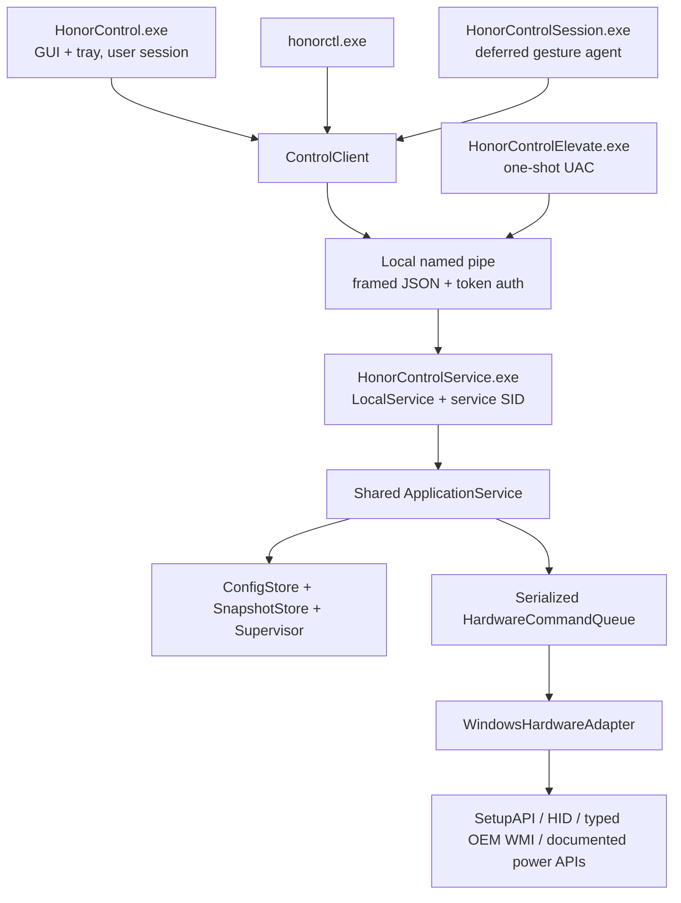

# Honor Control Windows Support Architecture and Implementation Plan

## 1. Status, scope, and evidence rules

**Status:** consolidated implementation plan. No Windows product implementation is claimed by this document.

This plan was produced by checking both earlier drafts against the current repository, the authoritative touchpad reverse-engineering artifacts, and current Microsoft platform documentation. Where the evidence is incomplete, the plan creates an experiment or release gate instead of choosing an implementation by assumption.

### Evidence vocabulary

- **Repository-confirmed:** proven by current source, tests, captures, or static analysis in this repository.
- **Platform-documented:** specified by Microsoft for the Windows API, but not necessarily tested on the target Honor laptop.
- **Target-validated:** executed successfully on an allowlisted laptop under the exact intended service identity and supported Windows build.
- **Experimental:** a plausible mechanism exists but the final call, permissions, semantics, readback, or recovery is incomplete.
- **Unknown:** no sufficient access path is known.

“Confirmed” must always include its scope. In particular, the nine-byte touchpad HID protocol is repository-confirmed from the updated OEM implementation, but Honor Control has not yet replayed it from its own Windows service on target hardware. It is therefore not production-ready until the target-validation gates pass.

### Authoritative repository evidence

- Current architecture and behavior: `README.md`, `pyproject.toml`,
  `docs/architecture.md`, `docs/dbus-api.md`, `docs/safety.md`,
  `docs/hardware-support.md`, `docs/development.md`, and
  `docs/gesture-linux-remaining-work.md`.
- Source: `honor_control/core`, `honor_control/backend`, `honor_control/client`, `honor_control/cli`, and `honor_control/frontend`.
- Touchpad source of truth: `Reverse engineering/README.md`,
  `Reverse engineering/finish-trackpad-re/protocol.json`, and
  `Reverse engineering/finish-trackpad-re/linux/PORTING_SPEC.md`.
- Historical local captures informed those compact tracked sources, but are not
  required to understand or implement the plan. Their discarded “ordinary
  settings use the EC/WMI driver” conclusion is superseded by the newer HID
  analysis.

### External platform references

- [LocalService account](https://learn.microsoft.com/en-us/windows/win32/services/localservice-account)
- [Service isolation, required privileges, and service SIDs](https://learn.microsoft.com/en-us/windows/win32/services/service-changes-for-windows-vista)
- [Named-pipe security and access rights](https://learn.microsoft.com/en-us/windows/win32/ipc/named-pipe-security-and-access-rights)
- [CreateNamedPipe](https://learn.microsoft.com/en-us/windows/win32/api/winbase/nf-winbase-createnamedpipew)
- [Impersonating a named-pipe client](https://learn.microsoft.com/en-us/windows/win32/ipc/impersonating-a-named-pipe-client)
- [RegisterServiceCtrlHandlerEx](https://learn.microsoft.com/en-us/windows/win32/api/winsvc/nf-winsvc-registerservicectrlhandlerexw)
- [Registering for power events](https://learn.microsoft.com/en-us/windows/win32/power/registering-for-power-events)
- [Sending HID reports from user mode](https://learn.microsoft.com/en-us/windows-hardware/drivers/hid/sending-hid-reports)
- [Obtaining HID reports](https://learn.microsoft.com/en-us/windows-hardware/drivers/hid/obtaining-hid-reports)
- [Power-scheme management](https://learn.microsoft.com/en-us/windows/win32/power/managing-power-schemes)
- [Windows services and user interaction](https://learn.microsoft.com/en-us/windows/win32/services/interactive-services)
- [Windows 11 release information](https://learn.microsoft.com/en-us/windows/release-health/windows11-release-information)

## 2. Executive summary

Honor Control should retain one shared domain/application layer and add narrow Windows implementations around it. Linux keeps systemd, D-Bus, polkit, sysfs, `hidraw`, `uinput`, `acpi_call`, and honor-tools. Windows adds an SCM service, secure local named-pipe transport, Windows discovery/HID/WMI helpers, Windows persistence/logging, and a platform client factory.

The Windows process model is:

- `HonorControlService.exe`: delayed-start SCM service, initially targeted at `NT AUTHORITY\LocalService` with an enabled per-service SID. It is the only machine-hardware owner.
- `HonorControl.exe`: unelevated per-user Qt GUI.
- `HonorControlTray.exe`: unelevated per-user tray process, preserving the current separate GUI/tray entry points while sharing controller code.
- `honorctl.exe`: unelevated CLI with stable human and JSON output.
- `HonorControlElevate.exe`: signed, one-shot UAC helper that can redeem only a service-created, short-lived operation nonce.
- `HonorControlSession.exe`: deferred user-session gesture agent, added only if custom Windows gesture actions are validated and cannot reliably live in the tray process.

The shared code remains responsible for validation, desired/applied/observed state, snapshot publication, sequencing, serialized hardware calls, reconciliation, CLI semantics, and most GUI behavior. Platform code owns transport, authorization, service lifecycle, paths/ACLs, logging, device discovery, native I/O, action dispatch, and OS-specific feature models.

The first Windows deliverable is a **read-only beta** with service/IPC/security, exact detection, diagnostics, shared clients, packaging, and capability reporting. A **stable Windows release** additionally requires at least one reversible control that passes the complete target-hardware, permission, lifecycle, coexistence, and recovery matrix. The likely control candidates are:

1. a documented Windows power operation, only if its per-user versus machine scope is correct for the architecture and it has reliable readback/restore; or
2. the exact-gated touchpad HID setting writer, shipped first as an administrator-approved, default-off Preview because the OEM protocol has no value readback.

Battery protection writes, Honor performance modes, CPU package limits, fan control, GPU control, the OEM touchpad master switch, and custom gestures are deferred until their own evidence gates pass. A feature missing its gate is absent or reported unavailable; implementation milestones never broaden the hardware allowlist automatically.

## 3. Current architecture assessment

### 3.1 Runtime flow today

The GUI and tray use `GuiController`; the CLI and controller construct `SdbusClient`. Calls reach `org.honorlinux.Control1`, where the D-Bus layer decodes arguments, captures the caller, performs polkit authorization, and delegates to `ApplicationService`. The application coordinates `ConfigStore`, `SnapshotStore`, `RuntimeSupervisor`, and a one-worker `HardwareCommandQueue`. `HonorToolsAdapter` and the Linux touchpad/gesture transports perform hardware I/O. State-change events contain a sequence and changed domains; clients refetch the authoritative snapshot.

Two existing abstractions are valuable:

- `ControlClient` is the frontend-facing async contract.
- `HardwarePort` is the application-facing synchronous hardware contract whose calls run through `HardwareCommandQueue`.

They are necessary but not sufficient portability seams. Today, importing or constructing several supposedly shared modules still pulls in Linux-only code.

### 3.2 What is already reusable

| Area | Disposition | Required change |
|---|---|---|
| `backend/command_queue.py` | Shared | Keep single-worker serialization and poison-after-timeout semantics; add hardware-generation metadata only when Windows lifecycle tests need it. |
| `backend/snapshot_store.py` | Shared | No architectural change. |
| `backend/supervisor.py` | Shared | Inject normalized lifecycle signals and capability changes. |
| `core/touchpad.py` | Shared | Keep the typed nine-byte report encoder, support query, and setting validation. |
| `core/errors.py` | Shared | Keep stable domain codes; move D-Bus name mapping out of the domain module and add any genuinely cross-platform codes such as `outcome_unknown`. |
| `core/models.py` | Shared after cleanup | Preserve immutable DTOs, but stop forcing Linux PPD/governor/EPP/RAPL fields to represent Windows state. Add capability parameter metadata and nullable observed fields. |
| `core/validation.py` | Shared plus platform validators | Keep neutral numeric/profile validation; move Linux key-code and Linux power-schema checks beside their platform models. |
| `backend/config_store.py` | Shared logical schema | Extract path selection, ACL verification, atomic replacement, and ownership policy. Add explicit schema migration functions; older-version default loading is not a complete migration system. |
| `backend/application.py` | Shared after dependency injection | Inject hardware, gesture lifecycle, log reader, diagnostics/probe provider, transition runner, and platform capability schema. |
| `client/protocol.py` | Shared | Keep as the only frontend client dependency; add negotiated capabilities/version information without exposing pipe or D-Bus details. |
| GUI pages/state/widgets | Mostly shared | Render controls from capabilities and parameter schemas; keep Linux-only advanced power and hook panels gated. |
| CLI handlers/output | Mostly shared | Inject the client factory; separate platform-neutral commands/output from Linux `--bus` and systemd help. |

### 3.3 Concrete portability blockers

1. `backend/hardware.py` defines `HardwarePort` but imports Linux `gesture_runtime` and `touchpad_firmware` at module import time. Move the protocol and neutral result types to `backend/ports.py`; keep `HonorToolsAdapter` in a Linux module behind a compatibility import.
2. `backend/application.py` imports `GestureRuntime`, `TouchpadFirmwareError`, and Linux helpers directly. Replace them with protocols/neutral exceptions before attempting a Windows import.
3. `client/sdbus_client.py` imports `client/proxy.py`, which imports `sdbus` at module import time. A Windows factory must never import this module unless Linux D-Bus is selected.
4. `frontend/gui/controller.py` and `cli/honorctl.py` construct `SdbusClient` directly and use Linux-specific timeout/help names.
5. `contract.py` mixes neutral version numbers with D-Bus names, paths, interface names, and errors.
6. `backend/dbus/codec.py` interleaves useful DTO/dict serialization with D-Bus variant wrapping.
7. `core/gestures.py` combines neutral gesture report decoding with Linux input-event key codes; `core/validation.py` imports that Linux table.
8. `ApplicationService.get_recent_logs()` shells out to `journalctl`.
9. Transition hooks use POSIX ownership/mode checks, `shlex` POSIX parsing, process groups, signals, and `start_new_session`.
10. `ConfigStore` hard-codes `/var/lib`, `fchmod(0640)`, and directory `fsync` behavior.
11. Tray and GUI contain freedesktop icon, desktop-file, `systemctl`, PATH launch, and POSIX process flags.
12. `pyproject.toml` declares `sdbus` unconditionally and describes/classifies the package as Linux-only.

### 3.4 Migration principle

Do not move the entire tree for symmetry. First add neutral modules and compatibility re-exports, prove Linux behavior unchanged, then add Windows siblings. A file moves only when a second implementation or import-safety boundary makes the move useful.

## 4. Requirements and compatibility scope

### 4.1 Functional requirements

- Install, start, stop, repair, upgrade, and uninstall without a separately installed Python runtime.
- Keep GUI, tray, and CLI on the shared `ControlClient` contract.
- Detect exact model and device interfaces without writes; return a reason for every unavailable capability.
- Support multiple local users and clients against one machine-owned hardware state.
- Reconnect after service restart; fetch a full snapshot after reconnect or a sequence gap; never replay mutations automatically.
- Persist validated desired policy and reconcile only explicitly enabled, target-validated settings after start/resume.
- Provide stable human and JSON CLI output and a redacted diagnostics bundle.
- Preserve Linux behavior and packaging throughout the migration.

### 4.2 Safety requirements

- One service-owned serialized hardware writer.
- Feature-specific conjunctive allowlists; no fallback platform or “close enough” match.
- No arbitrary HID report, WMI method, IOCTL, EC offset, device path, executable, or scan-code API.
- Validate a complete operation before opening/writing where practical.
- Distinguish `desired`, `last_accepted`, `observed`, `transport_accepted`, `outcome_unknown`, and `stale` where the hardware permits different evidence levels.
- A timeout does not prove a native operation did not reach hardware. Poison or invalidate the queue/handle generation until late completion or rediscovery resolves the state.
- No automatic retry after an ambiguous mutation.
- Experimental features are disabled by default and cannot be enabled by a generic production bypass.

### 4.3 Security requirements

- GUI, tray, CLI, and session helpers remain unelevated.
- Explicit ACLs for service data, binaries, logs, named pipes, and helper state.
- Per-request caller authentication from the kernel token, never JSON-supplied identity.
- First release: all machine policy/hardware mutations require an elevated administrator token; later relaxation is per-method and requires a new threat review.
- The elevation helper is a fixed client, not an arbitrary command or parameter forwarder.
- Service and helpers use absolute installed paths; no shell lookup, current-directory DLL lookup, or user-writable executable/config roots.
- No dependence on network access or network identity.

### 4.4 Compatibility target

- Initial support: x64 Windows 11 releases still within Microsoft servicing support and explicitly present in the release test matrix.
- Do not promise Windows 10 Home/Pro: general support ended on 2025-10-14. A separately tested ESU/LTSC build can be considered later without weakening the Windows 11 baseline.
- Initial hardware scope: exact `HONOR` / `MRA-XXX` rows validated per feature. Marketing name alone is never an allowlist.
- Python, PySide6, pywin32, freezer, WiX, and Windows SDK versions are pinned only after the frozen-service/GUI proof; CI then owns the upgrade cadence.

## 5. Proposed cross-platform architecture

### 5.1 Package layout

```text
honor_control/
  core/
    errors.py
    models.py
    validation.py
    gestures.py                 # semantic events only
    touchpad.py                 # confirmed typed wire encoder
  contract/
    api.py                      # neutral versions, method/event definitions
    codec.py                    # DTO <-> plain Python values
  backend/
    application.py
    ports.py                    # HardwarePort and platform service protocols
    command_queue.py
    config_store.py
    snapshot_store.py
    supervisor.py
  client/
    protocol.py
    factory.py
    errors.py
  platform/
    linux/
      composition.py
      dbus/
      hardware.py
      gestures.py
      paths.py
      logs.py
      transitions.py
    windows/
      composition.py
      service.py
      scm.py
      ipc_server.py
      ipc_client.py
      authorization.py
      elevation.py
      discovery.py
      paths.py
      logs.py
      lifecycle.py
      hardware/
        adapter.py
        hid.py
        wmi.py
        power.py
        touchpad.py
        fake.py
      session/
        agent.py                # deferred until custom gestures pass gates
        actions.py
```

During migration, old Linux module paths re-export the moved implementations so existing imports and entry points remain stable.

### 5.2 Shared ports

Keep `HardwarePort` high-level and synchronous. Add only the OS seams already proven necessary:

```python
class GestureRuntimePort(Protocol):
    async def start(self) -> None: ...
    async def stop(self) -> None: ...
    def status(self) -> GestureRuntimeStatus: ...

class PlatformDiagnosticsPort(Protocol):
    def collect(self) -> dict[str, object]: ...

class LogReader(Protocol):
    async def recent(self, lines: int) -> list[str]: ...

class TransitionRunner(Protocol):
    async def run(self, transition: str, operation_id: str) -> TransitionResult: ...

class PersistencePlatform(Protocol):
    def state_path(self) -> Path: ...
    def verify_root(self, path: Path) -> None: ...
    def atomic_replace(self, path: Path, data: bytes) -> None: ...
```

Do not create a generic native-call port. HID, WMI, and power helpers expose fixed typed operations only inside the Windows adapter.

### 5.3 Process and data flow



The service owns one machine-global desired state and monotonic snapshot sequence. Per-user preferences remain outside the service. A future gesture agent owns only active-session action delivery; it does not become a second hardware writer.

## 6. Windows service design

### 6.1 Identity and privilege

Target `NT AUTHORITY\LocalService`, configured with `SERVICE_SID_TYPE_UNRESTRICTED` initially so `NT SERVICE\HonorControl` can be used in ACLs. Configure `SERVICE_CONFIG_REQUIRED_PRIVILEGES_INFO` after measuring the exact needs; retain `SeImpersonatePrivilege` only because named-pipe token capture requires it. LocalService has minimal local privilege and anonymous network credentials, which matches this service.

Milestone 0 must install a real probe service and test discovery, safe reads, HID open modes, query-only WMI, and one approved reversible write under the final token. Do not infer permissions from an OEM process running as SYSTEM.

If LocalService cannot access a nonessential feature, omit that feature. If a production-required feature genuinely requires SYSTEM and its device/WMI ACL cannot be narrowed, design a separate `HonorControlHardwareBroker.exe` with:

- a service-SID-only private pipe;
- a tiny fixed operation allowlist;
- no parsing of public JSON;
- no state/config/UI code;
- a separate ADR, threat model, and tests.

Do not switch the entire main service to LocalSystem as a convenience fallback.

### 6.2 Composition and SCM host

`HonorControlService.exe` contains no Qt and does not depend on the interactive user profile. It constructs Windows paths, persistence, logging, diagnostics, `WindowsHardwareAdapter`, the shared stores/queue/application/supervisor, IPC server, and SCM bridge.

Use pywin32 for SCM/security/Event Log primitives after a frozen-build proof. Use small reviewed `ctypes` declarations only for missing structures or flags. `ServiceMain` registers `RegisterServiceCtrlHandlerEx` immediately; the handler posts bounded normalized events to the application loop and returns promptly.

### 6.3 Lifecycle

- Install as an own-process, delayed automatic service.
- Report `SERVICE_RUNNING` only after state validation, IPC readiness, read-only discovery, and initial snapshot publication. Missing optional hardware does not fail the service.
- Configure bounded restart-on-crash recovery with escalating delays and a reset period. Never configure an arbitrary recovery executable.
- Stop/preshutdown: reject new mutations, unsubscribe clients, stop session leases, cancel timers, request only proven safe restoration, close/cancel native handles, flush state/logs, and exit within a fixed budget. A stuck OEM call cannot block shutdown forever.
- Device notifications require explicit registration (`RegisterDeviceNotification` or a tested Configuration Manager notification path); accepting `SERVICE_CONTROL_DEVICEEVENT` alone is not enough.
- Power-setting notifications require explicit `RegisterPowerSettingNotification` registrations. Treat Modern Standby notifications as best-effort; safety must not depend on receiving a pre-sleep callback.
- On device removal, invalidate the hardware generation, cancel overlapped I/O, close handles, mark capabilities unavailable/stale, and reject queued work from an older generation.
- On arrival/resume, debounce, increment the generation, rediscover read-only, refresh observed state, then reconcile only opt-in target-validated settings.
- Handle both service start and resume paths; do not assume Fast Startup always presents as only one of them.
- Session logon/logoff/lock/unlock changes subscribers and a future gesture lease, never machine hardware ownership.

### 6.4 Multi-user behavior

Machine policy is global. Concurrent writes are serialized, with last accepted request winning; logs record request ID, initiating SID/session, approving SID when different, hardware generation, and outcome. The service never launches UI into a user session. Each session may run a client; at most one active-session helper may own custom gesture actions.

## 7. IPC and authorization

### 7.1 Transport

Use a local duplex byte-mode named pipe such as `\\.\pipe\HonorControl-v1` with:

- four-byte little-endian frame length followed by strict UTF-8 JSON;
- overlapped I/O, `PIPE_WAIT`, `PIPE_REJECT_REMOTE_CLIENTS`, and `FILE_FLAG_FIRST_PIPE_INSTANCE` on the first instance;
- explicit DACL, not the permissive default descriptor;
- maximum 1 MiB frames, bounded JSON depth/item/string counts, at most 16 connections, eight outstanding requests per connection, and bounded event queues;
- duplicate-key and non-finite-number rejection;
- `CancelIoEx`/handle closure during shutdown or generation invalidation.

Use a small closed request/response/event schema rather than full JSON-RPC 2.0. Batch calls, arbitrary notifications, and extension fields are unnecessary attack surface.

### 7.2 Wire contract

Illustrative version-1 messages:

```json
{"type":"hello","id":1,"transport":1,"api":{"major":1,"minor":0},"schema":{"min":4,"max":4},"client":"gui"}
{"type":"request","id":2,"method":"snapshot.get","params":{},"deadline_ms":5000}
{"type":"response","id":2,"result":{"sequence":42,"snapshot":{}}}
{"type":"response","id":3,"error":{"code":"not_authorized","message":"Administrator approval required","retryable":false}}
{"type":"event","event":"state_changed","sequence":43,"domains":["power","capabilities"]}
```

- Keep transport version, application API version, and snapshot schema version distinct. The current application API is 1 and snapshot schema is 4; adding Windows transport does not itself require an API major bump.
- Major mismatch fails. Minor additions and schema ranges are negotiated; clients must not require exact equality forever.
- Request IDs are connection-local unsigned 64-bit values. Methods and parameter shapes are fixed allowlists.
- Deadlines are capped and advisory. Disconnect/cancel stops waiting, but does not pretend a non-cancellable native call was stopped.
- Events carry sequence/domains only. A slow client gets a resync marker, then refetches a full snapshot.
- After restart, clients reconnect with bounded exponential backoff and jitter, renegotiate, and refetch. Mutations are never replayed automatically.
- Stable wire errors use the exact `DomainError` vocabulary; platform details remain redacted diagnostics.

### 7.3 Pipe security and server verification

The pipe descriptor grants the service SID/SYSTEM/Administrators the necessary server rights and local authenticated clients only the individual client-end rights required to connect/read/write. Do **not** grant client `FILE_GENERIC_WRITE`: Microsoft documents that its `FILE_APPEND_DATA` bit is also `FILE_CREATE_PIPE_INSTANCE`, which can permit a client to create a pipe instance. Integration tests must prove a standard user can connect but cannot create an instance.

Also deny network/anonymous access and set `PIPE_REJECT_REMOTE_CLIENTS`. If product policy later limits access to specific sessions, use logon SIDs; do not confuse `Authenticated Users` with “interactive local user.”

After opening the pipe, clients verify the server PID with `GetNamedPipeServerProcessId`, compare it with the SCM-reported service process, resolve the expected Program Files image, and verify the installed signed file identity before sending credentials or requests. Any mismatch closes the handle.

### 7.4 Per-request authentication and authorization

Each connection worker reads a request and authenticates it on that same thread:

1. Call `ImpersonateNamedPipeClient` after reading the request; check the return value.
2. Open the thread token and copy only bounded facts: user SID, group SIDs, session ID, elevation type/state, integrity level, token origin/logon type as available.
3. Always call `RevertToSelf` in a guaranteed cleanup path. Authentication/reversion failure closes the connection without dispatch.
4. Apply the immutable method policy per request. Identity fields in JSON are ignored.

Initial tiers:

| Tier | Rule | Examples |
|---|---|---|
| Public local health | Valid local pipe connection | Protocol hello and service version only |
| Interactive read | Authenticated local interactive token | Snapshot, capabilities, redacted diagnostics/logs, configuration view |
| Administrative mutation | Elevated token and Administrators membership | Every hardware write, machine policy change, experimental enablement, config repair/migration |
| Internal | Separate descriptor/pipe and explicit service/session identity | Future broker or session-agent lease only |

Unknown methods fail closed before application dispatch. A filtered administrator token is not elevated. Reconsidering standard-user mutations is a later per-method ADR, not a blanket “active user” tier copied from polkit.

### 7.5 UAC helper

1. Unelevated client sends `elevation.prepare` with a typed method/parameter object.
2. Service validates syntax/capability, hashes the canonical operation, and stores a 256-bit random, one-use nonce bound to initiating SID/session, request, hardware generation, and a 60-second expiry.
3. Client launches the absolute signed `HonorControlElevate.exe` using the `runas` verb, passing only the nonce and transport version.
4. Helper connects with its elevated token and redeems the nonce. Service verifies elevation/admin membership, same initiating session, expiry, one-time use, operation hash, and current capability/generation.
5. For a split-token administrator, initiating and approving SIDs normally match. For a standard user entering different administrator credentials, the approving SID may differ; allow this only as an explicit over-the-shoulder approval, log both SIDs, and keep the nonce bound to the initiating session and exact operation.
6. Result reaches the original client through its pending request or authoritative snapshot/event. No approval is cached.

The helper never accepts method names, JSON parameters, executable paths, device paths, or native command values on its command line. JSON CLI mode never opens UAC unexpectedly; elevation requires an explicit flag or returns a stable approval-required error.

## 8. Windows hardware-access design

### 8.1 Adapter layers

`WindowsHardwareAdapter` implements the shared synchronous `HardwarePort` behind `HardwareCommandQueue` and uses fixed helpers:

- `discovery.py`: SMBIOS identity, Windows build, SetupAPI/Configuration Manager device tree, HID attributes/caps, and Honor software/driver inventory.
- `hid.py`: exact collection enumeration, minimal handles, overlapped read/write, cancellation, and generation invalidation.
- `wmi.py`: typed allowlisted query/method wrappers with strict shape checking; never a generic WMI executor.
- `power.py`: documented Windows telemetry and separately scoped power-scheme/mode experiments.
- `touchpad.py`: typed HID reports and separately gated OEM master-switch calls.
- `fake.py`: deterministic success/failure/timeout/removal/resume/conflict backend.

Paths are discovered internally and bound to identity records. No IPC/config parameter can select a native device.

### 8.2 Feature classification

| Feature | Candidate mechanism | Evidence now | Release treatment |
|---|---|---|---|
| Model/device detection | SMBIOS/WMI plus SetupAPI/CM/HID caps | Platform-documented; target matching unvalidated | Required read-only |
| AC/battery telemetry | `GetSystemPowerStatus` plus validated battery APIs | Platform-documented; target accuracy unvalidated | Required only for fields that pass comparison |
| Windows power scheme/mode | `PowerGetActiveScheme`/`PowerSetActiveScheme` or Windows 11 user-configured power-mode APIs | Platform-documented; identity/scope behavior unvalidated | Candidate reversible control, not assumed machine-global |
| Linux PPD/governor/EPP/RAPL/PL1/PL2 | No direct semantic equivalent | Unknown | Unsupported/deferred |
| Battery charge protection | Historical PC Manager setting correlation; final native boundary/readback missing | Experimental | Writes deferred |
| Fan mode/curve/manual | No validated call, sensor, auto restore, or model matrix | Unknown/high risk | Unsupported first release |
| Thermal sensors | Documented reading only if target accuracy passes | Unknown | Optional read-only |
| GPU control | No Windows path; Linux path intentionally non-writable | Unknown/not planned | Unsupported |
| Honor performance modes | OEM components observed; no stable typed API proven | Experimental | Deferred |
| Touchpad firmware settings | Exact nine-byte HID Output reports to vendor collection | Repository-confirmed offline; target replay missing; no value readback | Preview only after M0/M4 |
| Touchpad master switch | Exact OEM WMI contract | Repository-confirmed contract; Windows permission/firmware/recovery unvalidated | Deferred separate gate |
| Gesture input | Nine-byte input format is repository-confirmed | Reader access/coexistence/session behavior unvalidated | Research/optional |
| Gesture actions | User-session Windows APIs or OEM handler | Mechanism-specific behavior unvalidated | Deferred |

### 8.3 Discovery and allowlists

A writable capability requires all predicates relevant to that feature:

- exact manufacturer/product row;
- exact PnP ancestry and collection usage;
- VID/PID and report descriptor/caps;
- input/output lengths and report IDs;
- required WMI namespace/class/instance/method/input/output shapes;
- service-token access;
- compatible coexistence mode;
- current hardware generation;
- explicit experimental opt-in where applicable.

The observed touchpad release `0x0101`, BIOS `3.05`, and EC `3.5` are evidence to record, **not selectors by themselves**. The authoritative porting specification says the descriptor selects the collection. A future release/BIOS/EC bound becomes a gate only after target-matrix evidence proves it is necessary and sufficient.

Discovery caches only within a hardware generation. It reports every failed predicate without leaking arbitrary paths to unprivileged clients.

### 8.4 Native-call behavior

- Use minimal access/share flags proven by M0; do not assume `GENERIC_READ|GENERIC_WRITE` is always required for every operation.
- Use overlapped HID I/O and `CancelIoEx` where supported, but treat cancellation as unproven until completion status is observed.
- A timeout produces `outcome_unknown` for a write without readback and prevents blind retry.
- After removal/resume/driver restart, close old handles and reject stale-generation work.
- Never expose the historical HNOs2EC IOCTL set. Its caller allowlist and discovered dispatch table do not prove safe public buffer semantics.
- Do not spoof an OEM process name or redistribute Honor binaries/drivers without explicit license and API evidence.
- A custom kernel driver is outside the planned stable scope. It requires a new feature-specific ADR, signing/Secure Boot/HVCI plan, fixed IOCTL design, fuzzing/Verifier/HLK, recovery, and a long-term maintainer.

### 8.5 Power scope correction

`PowerSetActiveScheme` is documented as setting the active scheme for the **current user**. Windows 11 user-configured power-mode APIs are also explicitly user-scoped votes that other system signals can override. A LocalService call must therefore not be presented as interactive-user or machine-global state without an experiment proving the exact behavior.

M0 must compare calls under LocalService, a normal interactive user, and an impersonated/explicit session component. If the setting is per-user, implement it through an authenticated user-session component with per-user desired state, or defer it. Do not store it in the machine-global `HardwarePort` snapshot merely because the API returns a GUID.

## 9. Touchpad and gesture design

### 9.1 Resolve the two reverse-engineering generations

The historical investigation associated ordinary settings with OEM IPC, the HNOs2EC driver, WMI, and EC behavior. The newer `finish-trackpad-re` work examined the updated `MagicTouchPadPlugin.dll` and identifies the final boundary:

```text
MagicTouchPadSettingUI/helper IPC
  -> PCManagerMainService / MagicTouchPadPlugin
  -> typed setting method
  -> HIDClient::WriteToDev
  -> overlapped WriteFile to vendor collection COL05
```

Ordinary settings are HID Output reports. Only the global master switch uses `ROOT\WMI:OemWMIMethod.OemWMIfun`. Old IOCTL/WMI guesses must not be revived as alternate setting commands.

### 9.2 Exact protocol

Target evidence:

| Property | Value |
|---|---|
| DMI scope | `HONOR` / `MRA-XXX` |
| ACPI ancestry | `TOPS0102` |
| HID | I2C `35cc:0104`; observed release `0101` |
| Collection | Windows `COL05`, Application usage page `ff00`, usage `0001` |
| Reports | ID `0x0e`, 9-byte Input and 9-byte Output including report ID |

Setting output is `0e CC VV 00 00 00 00 00 00`:

| Order | Setting | Command | Values |
|---:|---|---:|---|
| 1 | sensitivity | `01` | low `0`, high `1` |
| 2 | vibration intensity | `02` | low `0`, medium `1`, high `2` |
| 3 | press text | `03` | off/on |
| 4 | press picture | `04` | off/on |
| 5 | three-finger drag | `05`, then `11` | same off/on value in both |
| 6 | mouse-like mode | `06` | off/on |
| 7 | edge brightness | `07` | off/on |
| 8 | edge volume | `08` | off/on |
| 9 | edge control center | `09` | off/on |
| 10 | edge close/minimize | `0a` | off/on |
| 11 | knuckle screenshot | `0b` | off/on |
| 12 | knuckle screen recording | `0c` | off/on |

Lifecycle/support reports:

- clock: `0e 00 TT TT TT TT TT 00 00`, low 40 bits of Unix time, little-endian;
- support query: `0e f0 00 00 00 00 00 00 00`;
- response: `0e f0` plus seven bitmap bytes, LSB-first;
- internal reset `0e 0e ...` and legacy aliases are never public operations.

The firmware exposes no setting-value readback. A complete nine-byte `WriteFile` result proves transport acceptance only. Desired state, accepted report count, and observed value (`None`) remain distinct; partial transactions cannot claim rollback.

### 9.3 Windows writer

1. Enumerate top-level HID collections with SetupAPI/CM.
2. Verify DMI, ancestry, VID/PID, usage page/usage, input/output lengths, and report ID. Zero or ambiguous matches disable writes.
3. Log the observed release/BIOS/EC but do not use them as unsupported shortcut selectors.
4. Validate the entire profile before opening.
5. Open with the minimum access/share flags proven by M0 and overlapped I/O.
6. Build bytes only with `core/touchpad.py`; require exactly nine bytes accepted.
7. Send clock if M0 proves the Windows sequence requires it; apply settings in canonical order; always pair `05` then `11`.
8. Serialize support-query reading against all other readers.
9. On partial failure, return exact accepted/failed settings, mark outcome truthfully, and do not retry automatically.
10. On resume/reconnect, rediscover and reapply only when persistence is enabled and coexistence/generation gates pass.

Prefer direct Windows SetupAPI/HID calls through reviewed pywin32/`ctypes` wrappers because exact caps and collection selection are safety gates. Adopt the binary `hid`/hidapi package only if M0 proves it exposes every required identity/capability and packages cleanly; do not choose it merely for convenience.

### 9.4 Master switch

The separate OEM contract is:

- namespace `ROOT\WMI`;
- class `OemWMIMethod`, method `OemWMIfun`;
- instance `ACPI\PNP0C14\HWMI_0`;
- method ID `1`;
- 64-byte input: little-endian `u64` command plus 56 zero bytes;
- 256-byte output: byte 0 status, byte 1 enabled;
- query `0x00000f02`, disable `0x00001002`, enable `0x00011002`.

This is an undocumented OEM WMI interface, not a generally supported public Windows API. First test query-only under LocalService. A write requires an external pointing device, query/change/query/restore, firmware matrix, resume/recovery, and provider-without-PC-Manager tests. Until all pass, the master switch is unavailable in production.

### 9.5 Honor coexistence

Inventory relevant Honor services/processes/drivers and test actual open/share behavior. Never stop, disable, rename, patch, or impersonate Honor software.

- Coexist if both sides can open the collection and repeated tests show no report loss or oscillation.
- If ownership is exclusive or conflict is detected, mark the feature `busy/conflict`, disable persistence/automation, and explain that the user must choose one owner.
- Support query has one reader. Stop or lease the custom reader around it; PC Manager reader races remain an explicit M0 test.
- “Honor-managed gestures” may leave action handling to OEM software while Honor Control manages only target-validated settings.

### 9.6 Gesture runtime

Windows services run in session 0 and must not inject user input. Use this sequence:

1. Determine whether Honor software already consumes the reports and performs acceptable actions. If so, prefer OEM handling and do not add a second reader.
2. If custom remapping is valuable, test Raw Input in an unelevated session process.
3. If Raw Input is insufficient, test one-owner overlapped `ReadFile`. If only the service can read, it may forward decoded semantic events to a leased active-session agent; the service never calls `SendInput`.
4. Output uses a fixed Windows semantic-action allowlist. Volume/media keys and fixed window shortcuts may use documented APIs/`SendInput`; brightness, recording, and shell actions remain unavailable until target-validated.
5. On lock/logoff/session switch/suspend, release the lease and discard queued actions.

Move Linux `KEY_CODES` to the Linux platform. Keep report decoding and semantic gesture IDs shared. Never accept arbitrary scan codes, key sequences, shell commands, or executable mappings from IPC/config.

## 10. Configuration, state, and logging

### 10.1 Storage

Resolve known folders through Windows Known Folder APIs rather than trusting environment variables.

| Data | Location | Access |
|---|---|---|
| Binaries/resources | `%ProgramFiles%\Honor Control\` | Installer/Administrators write; Users read/execute; immutable at runtime |
| Machine desired state | `%ProgramData%\Honor Control\state.toml` | service SID/SYSTEM write; Administrators read as policy permits; Users no direct access |
| Last-known-good backup | same directory, `state.toml.bak` | same ACL |
| Service logs | `%ProgramData%\Honor Control\Logs\` | service SID/SYSTEM write; redacted access through IPC |
| Crash dumps | `%ProgramData%\Honor Control\CrashDumps\` | opt-in, restricted, bounded retention |
| GUI/tray preferences | QSettings NativeFormat under HKCU or `%LocalAppData%` | owning user only |
| GUI/tray logs | `%LocalAppData%\Honor Control\Logs\` | owning user only |
| Temporary state writes | random create-new file below the state root | same volume/ACL; no shared `%TEMP%` privileged replacement |

### 10.2 Persistence rules

- Keep the logical TOML schema and validation shared; add explicit N-to-N+1 migrations with fixtures.
- Verify the root and every path component against reparse/junction attacks before privileged replacement.
- Create temp files with restrictive ACLs, flush file content, replace atomically on the same volume, and preserve a validated backup.
- A future schema or invalid file starts in safe read-only/recovery mode; it never silently resets into hardware writes.
- Per-user state contains no hardware authority.
- Persist only desired policy and evidence-safe metadata, never runtime snapshots as observed truth.

### 10.3 Logging

Use a registered Event Log source for lifecycle, discovery summary, authorization denials (rate-limited), safety transitions, and crashes. Use bounded structured rolling files for detailed troubleshooting. Every record includes timestamp, component, request/correlation ID, feature, result class, and hardware generation where relevant.

Redact tokens/nonces, raw pipe payloads, environment variables, user documents, arbitrary device paths, raw WMI/HID buffers except explicitly safe protocol diagnostics, and secrets. `GetRecentLogs` reads through `LogReader`; it never shells out.

## 11. GUI, tray, and CLI portability

### 11.1 Client construction

Add `client/factory.py`:

- Linux imports and creates `SdbusClient` only on Linux.
- Windows imports and creates `WindowsPipeClient` only on Windows.
- Tests inject `FakeClient`/factories.
- Unsupported platforms return an explicit error without importing native modules.

Retype controller/CLI fields to `ControlClient`. Keep all I/O on the existing GUI worker thread.

### 11.2 Capability-driven UI

- Feature presence, writability, choices, ranges, evidence level, and reason codes come from capabilities.
- Do not display Linux PPD/governor/EPP/RAPL controls with fabricated Windows values.
- Distinguish unavailable, experimental, conflict, stale, desired, accepted, observed, and outcome-unknown states.
- Hardware writes show UAC intent before launching the helper and refresh from the service after approval.
- Windows service help replaces `systemctl`; icons/resources are bundled; DPI/dark-mode/multi-monitor behavior is tested.

### 11.3 Tray and startup

Use an absolute installed GUI path and Windows process creation flags. Enforce one tray instance per user session with a user/session-scoped mutex. Make tray autostart an explicit per-user installer/settings choice. Recover after Explorer restart. Do not use a global service mutex as a substitute for SCM ownership.

### 11.4 CLI

Preserve existing exit codes where semantics match. Add explicit `--approve` for interactive UAC; `--json` never prompts. Report unsupported features as structured capability errors. Keep the low-level Linux `honor-touchpadctl` Linux-only; a Windows diagnostic may enumerate/validate through the service but never exposes raw reports.

## 12. Packaging, installation, and signing

### 12.1 Python metadata

- Mark `sdbus==0.14.2` with `sys_platform == "linux"`.
- Add pinned Windows-only dependencies only after M0/M2 freezer proofs; likely pywin32, with raw HID wrappers kept minimal.
- Keep PySide6 optional/platform-appropriate.
- Add Windows service/elevation entry points without removing Linux entry points.
- Add Windows classifiers and neutralize the package description while retaining Linux classifiers.
- Add import-isolation tests so Windows never imports `sdbus`, `fcntl`, `signal`-only service code, hidraw, or uinput modules.

### 12.2 Build/install stack

Use pinned PyInstaller **onedir** builds plus a WiX MSI. WiX/MSI is selected for machine-wide service installation, repair, major upgrade, rollback, component ownership, and enterprise-compatible uninstall semantics. Keep installer choice isolated so concrete build failures can justify a later switch.

Installed artifacts:

- signed service, GUI/tray, CLI, and elevation helper;
- bundled Python/Qt/native dependencies and resources;
- service/Event Log registration;
- explicit Program Files/ProgramData/pipe ACL setup;
- Start Menu shortcuts and optional per-user tray startup;
- product/version/support manifest and uninstall metadata.

### 12.3 Service installation

The installer:

1. performs no hardware writes;
2. installs into a non-user-writable Program Files directory;
3. creates and ACLs ProgramData without following reparse points;
4. registers Event Log source;
5. installs the quoted own-process service under LocalService;
6. enables the service SID and required-privilege list;
7. configures delayed start, recovery, description, and preshutdown only when needed;
8. starts the service and verifies read-only health;
9. rolls back cleanly if health fails.

### 12.4 Signing and release artifacts

Sign every executable, DLL, and MSI with Authenticode and a timestamp. CI builds unsigned artifacts; an isolated release stage signs after tests. Publish hashes, SBOM, dependency/license inventory, support manifest, limitations, and recovery instructions. Audit DLL search paths and loaded modules in a clean VM. No custom driver or OEM binary is bundled.

### 12.5 Upgrade/uninstall

- Stop service, preserve validated ProgramData, replace versioned components transactionally, run schema migration, start, and verify health before commit.
- Block unsupported downgrade; test rollback from failed upgrade.
- Uninstall removes owned service/Event Log/program/startup components but preserves state by default.
- Purge is explicit, limited to the verified product data tree, and never touches Honor software or shared drivers.

## 13. Security threat model

| Threat | Control | Verification |
|---|---|---|
| Malicious local client invokes privileged writes | Per-request impersonation/token policy; all mutations elevated initially | Standard/filtered/elevated/admin-credential integration matrix |
| Same-named pipe squatting | First-instance flag, client ACE without create-instance, client SCM PID/image/signature verification | Pre-service squatting and reconnect race tests |
| Remote/anonymous pipe access | Explicit DACL, network deny, `PIPE_REJECT_REMOTE_CLIENTS` | Local/remote/anonymous tests and DACL inspection |
| Parser/resource exhaustion | Length prefix, strict schema, depth/count limits, connection/request/event quotas | Fuzz/property/load tests |
| Impersonation failure falls back to service identity | Check every call; close on failure; guaranteed `RevertToSelf` | Fault injection and token audit |
| UAC helper becomes confused deputy | One-use short nonce bound to typed operation/session/generation; helper receives no params | Replay, expiry, SID/session, different-admin approval tests |
| ProgramData junction/symlink attack | Known Folder root, reparse rejection, handle-based checks, same-dir replace | Adversarial filesystem tests |
| DLL/executable hijack | Immutable Program Files, absolute paths, safe DLL search, signing | ACL/load audit in clean VM |
| Raw native-call escape hatch | Fixed typed methods and internal device discovery | API/schema/AST review |
| Privileged transition hook abuse | Hooks disabled/deferred on Windows until separate design | No Windows hook implementation in initial release |
| Cross-session gesture injection | Active-session lease, unelevated agent, lock/logoff discard | Multi-session/UIPI tests |
| Sensitive diagnostics leak | Redaction, bounded fields, service-mediated export | Snapshot/log fuzz and privacy review |

## 14. Hardware safety model

Every write follows this pipeline:

```text
authenticated request
  -> authorization policy
  -> typed decode and shared validation
  -> capability/evidence/allowlist/conflict check
  -> hardware-generation check
  -> serialized command queue
  -> adapter boundary validation
  -> native call with deadline/cancellation semantics
  -> readback where available
  -> desired / accepted / observed result update
  -> snapshot + audit event
```

Mandatory rules:

- Validation occurs at both application and adapter boundaries.
- No write is enabled solely by vendor/product strings.
- Device removal/resume invalidates handles and queued generations.
- A late native completion is audited; it cannot overlap a later mutation unnoticed.
- Readback failure after transport success is partial/unknown, not success.
- No-readback touchpad settings can report reports accepted, never firmware truth or transactional rollback.
- Automatic reconciliation is opt-in per feature and disabled on conflict or repeated failure.
- First hardware experiments use an external power/input recovery path and record before/after evidence.
- Fan, battery, CPU/GPU, and unknown WMI/IOCTL experiments are never automated in CI.

## 15. Feature parity and release scope

| Feature | Linux | Windows read-only beta | First stable Windows | Later |
|---|---|---|---|---|
| Service/state/snapshots | Supported | Required | Required | — |
| GUI/tray/CLI | Supported | Required shared clients | Required | — |
| Exact platform/device detection | Supported | Required | Required | Extend only by evidence |
| Diagnostics/debug bundle/logs | Supported | Required, redacted | Required | — |
| Battery/AC telemetry | Supported | Only validated fields | Same | Improve accuracy matrix |
| Battery threshold/mode writes | Supported | Unavailable | Deferred | Final native call/readback required |
| Windows power scheme/mode | N/A | Read/research | Candidate required control if scope passes | Per-user component if necessary |
| Linux advanced power profiles | Supported on gate | Unavailable | Unsupported | Separate Windows model, never name mapping |
| Fan stock/curve/manual | Supported on narrow gate | Unavailable | Unsupported | Full access/sensor/restore evidence required |
| Touchpad firmware settings | Linux replay still gated | Probe only | Optional default-off Preview after full validation | Expand matrix cautiously |
| Touchpad support bitmap | Implemented | Probe after reader coordination | With Preview if reliable | — |
| Touchpad master switch | Linux ABI gate remains | Query research | Deferred | Query/change/query/restore matrix |
| Gesture decoding | Supported | Report research | OEM handling only if verified | Session agent after validation |
| Custom gesture actions | Linux uinput | Unavailable | Deferred | Fixed Windows action allowlist |
| GPU mitigation | Intentionally unavailable | Unavailable | Unsupported | New evidence/restore path required |
| Transition hooks | Supported Linux | Unavailable | Deferred | Separate Windows security design |

## 16. Research gates

### 16.1 Milestone 0 experiments

| ID | Experiment | Safe scope | Resolves |
|---|---|---|---|
| R0-01 | Capture exact SMBIOS, Windows build, driver, service, HID collection/caps, BIOS/EC inventory | Read-only | Initial support manifest and near-match fixtures |
| R0-02 | Install LocalService probe with service SID; enumerate/open/query each candidate under its real token | Read-only | Service identity and required privilege list |
| R0-03 | Enumerate COL05 through SetupAPI/HID; confirm usage/length/report ID and minimal open/share flags | Read-only | Windows HID implementation choice |
| R0-04 | Test support query with and without PC Manager/custom reader | Read/query only | Reader ownership and coexistence |
| R0-05 | Replay one benign reversible HID setting, restore immediately, repeat across service restart/resume | Explicit approval; external mouse and OEM UI available | Touchpad Preview gate |
| R0-06 | Query OEM master state under LocalService, with/without PC Manager/provider | Query only | Provider/permission/shape gate |
| R0-07 | Compare power scheme/mode calls under LocalService and interactive user, including readback/restore and session switch | Reversible documented API | Whether power belongs to service or user session |
| R0-08 | Compare OS battery/AC/thermal readings with OEM/Windows UI across states | Read-only | Telemetry accuracy |
| R0-09 | Freeze pywin32 service, Qt GUI, pipe client/helper; test clean VM startup, ACLs, cancellation, upgrade | No hardware writes | Packaging/IPC dependency freeze |
| R0-10 | Run PC Manager coexistence matrix for open/share/write/read behavior and oscillation | Reversible setting only after R0-05 | Conflict policy |

Each experiment records exact versions, identity/token, input, output, timings, errors, pre/post state, restore result, and raw evidence location. Failure disables the feature; it does not authorize a broader API.

### 16.2 Unsafe experiments requiring a separate proposal

- Brute-force WMI methods, IOCTLs, HID commands, EC ports, ACPI methods, or firmware values.
- Fan/manual/curve writes without validated temperature, stock-auto restoration, and external monitoring.
- Battery commands without final boundary, independent readback, and rollback.
- CPU/GPU register or package-limit writes.
- OEM caller-name spoofing, service patching, driver replacement, or disabling PC Manager automatically.
- Kernel driver installation or Secure Boot changes.

## 17. Testing and CI

### 17.1 Shared tests on Linux and Windows

- Domain validation, models, touchpad byte vectors, config migrations, application use cases, snapshots, supervisor, and queue behavior.
- Neutral codec golden vectors shared by D-Bus and pipe transports.
- `ControlClient` conformance suite for fake, D-Bus, and Windows pipe clients.
- Fake hardware scenarios: unavailable, unsupported, conflict, partial, stale, timeout/late completion, removal, resume, generation mismatch, and restoration failure.
- Frontend capability rendering and stable CLI JSON/exit codes.
- Forbidden-import tests for each platform.

### 17.2 Windows unit/integration tests

- Fragmented/coalesced/oversized/malformed frames, duplicate keys, depth/count limits, request collisions, slow readers, and backpressure.
- Real DACL and pipe flags; standard user cannot create an instance.
- Token cases: normal user, filtered admin, elevated admin, over-the-shoulder admin, service/batch/remote/anonymous denial, impersonation/reversion failure.
- UAC nonce replay, expiry, operation substitution, cross-session redemption, service restart, and generation change.
- SCM start/stop/preshutdown/recovery, Event Log registration, power/device notification registration, and bounded stuck-call shutdown.
- ProgramData ACL/reparse/atomic replace/disk-full/corrupt/future-schema tests.
- Fake device arrival/removal/resume and stale-generation rejection.
- PyInstaller/WiX clean install, repair, major upgrade, failed-upgrade rollback, downgrade block, uninstall preserve, and explicit purge.

### 17.3 Manual target-hardware matrix

For each supported row record laptop SKU, BIOS/EC, Windows build, HID/driver/Honor versions, PC Manager absent/present, service identity, AC/battery, cold boot, restart/crash, sleep/hibernate/Modern Standby as available, Fast Startup, device/driver restart, two-user sessions, concurrent clients, disconnect/timeout, and restore outcome.

No hardware-write test runs automatically on a developer laptop or public CI. Hardware jobs require a dedicated tagged runner, explicit feature allowlist, external recovery equipment, and human approval.

### 17.4 CI jobs

1. Linux Python matrix: current supported Python floor and release version; full suite/ruff/type/import checks.
2. Windows x64 Python matrix: shared plus Windows unit/fake/integration tests.
3. D-Bus contract job on Linux.
4. Frozen Windows build and smoke test.
5. MSI VM install/repair/upgrade/uninstall job.
6. Fuzz/property corpus for codec/config.
7. Dependency/license/SBOM/signature/load-path scanning.
8. Manual signed hardware validation before a stable release.

## 18. Migration and implementation roadmap

### Milestone 0 — Evidence and frozen-runtime proofs

Complete R0-01 through R0-10. Produce the per-feature evidence matrix, LocalService permission result, first control decision, native dependency decision, and packaging proof. No production hardware write is enabled.

### Milestone 1 — Platform separation with Linux unchanged

- M1-01: add golden API/schema/codec/client/error fixtures.
- M1-02: move `HardwarePort` and neutral touchpad results/errors to import-safe modules; compatibility re-export old paths.
- M1-03: extract neutral contract and DTO codec; keep D-Bus adapters byte-compatible.
- M1-04: extract gesture semantics from Linux key codes and validators.
- M1-05: inject gesture runtime, diagnostics, log reader, transition runner, and persistence platform into `ApplicationService`.
- M1-06: add client factory; remove direct `SdbusClient` construction/import from GUI/CLI.
- M1-07: add OS dependency markers and forbidden-import tests.

**Gate:** all existing Linux tests and a live fake session-bus smoke test remain green; Windows can import shared application/client/frontend modules without Linux dependencies.

### Milestone 2 — Secure Windows service and IPC with fake hardware

- M2-01: implement strict codec/framing, limits, error/version negotiation, reconnect/resync, and client conformance.
- M2-02: implement explicit pipe DACL, first-instance/local-only flags, server verification, per-request impersonation, and method policy.
- M2-03: implement nonce-bound elevation helper including different-admin credential approval.
- M2-04: implement SCM bridge, LocalService/service SID/required privileges, lifecycle queue, notification registration, Event Log, paths, and ACLs.
- M2-05: compose service with `WindowsFakeHardware`; run multi-client/multi-session/timeout/removal tests.

**Gate:** no real hardware adapter is required; all authorization, service, lifecycle, config, and IPC tests pass on a clean Windows VM.

### Milestone 3 — Read-only Windows beta

- M3-01: implement SMBIOS/SetupAPI/CM/HID inventory and capability reasons.
- M3-02: implement only validated telemetry fields and Honor conflict inventory.
- M3-03: implement redacted diagnostics/log access and debug bundle.
- M3-04: finish capability-driven GUI/tray/CLI and Windows service UX.
- M3-05: ship signed beta installer/support manifest after VM and target read-only tests.

**Gate:** unsupported/near-match hardware performs no writes; snapshot facts match independent tools; install/upgrade/uninstall and Linux regression gates pass.

### Milestone 4 — One reversible stable control and touchpad Preview

- M4-01: implement the winning R0-07 documented power control in the correct machine/user component, if it passed.
- M4-02: implement exact-gated HID writer, accepted/unknown result semantics, reader coordination, generation handling, and coexistence policy, if R0-05 passed.
- M4-03: keep touchpad persistence separate, default off, and labelled Preview.
- M4-04: implement master query only if R0-06 passed; master write remains its own later approval gate.
- M4-05: complete the manual lifecycle/restore matrix and independent security review.

**Gate:** stable release has at least one target-validated reversible control; otherwise the product remains a read-only beta.

### Milestone 5 — Product/release hardening

- Windows DPI/theme/multi-monitor/Explorer restart/single-instance checks.
- MSI repair/major-upgrade/rollback/downgrade/uninstall/purge matrix.
- Signing, SBOM, hashes, privacy/log documentation, recovery instructions, AV reputation process.
- Prior bundled-client compatibility and schema migration tests.

### Milestone 6 — Separately gated features

Order by evidence and risk, not by Linux parity: OEM-managed gesture integration, custom session gesture agent, master switch, battery protection, Honor performance modes, thermal reads, fan research. Each needs its own task set, ADR update, threat/safety review, capability gate, and manual matrix. GPU and any custom driver remain unsupported unless a new proposal demonstrates compelling value.

## 19. Architecture decisions

| ADR | Decision | Key reason |
|---|---|---|
| W01 service model | SCM service is sole machine hardware owner; UI clients unelevated | Preserves serialization, lifecycle, multi-user, and recovery invariants |
| W02 service identity | LocalService + service SID first; optional tiny SYSTEM broker only after proof | Least privilege; OEM SYSTEM use is not permission evidence |
| W03 IPC | Bounded framed JSON over local named pipe | Native token/ACL support without network/firewall or heavy RPC stack |
| W04 authorization | Per-request impersonation; all initial mutations elevated | Pipe possession is insufficient; conservative first-release policy |
| W05 elevation | One-use exact-operation nonce helper | Keeps GUI unelevated and avoids arbitrary privileged forwarding |
| W06 package structure | Shared core/backend/client plus platform implementations and compatibility imports | Minimal Linux churn with real import isolation |
| W07 hardware boundary | Keep high-level `HardwarePort`; add only proven OS-service ports | Avoid generic native APIs and premature interface forests |
| W08 touchpad | Exact-gated direct HID settings; OEM WMI master separate; no old EC IOCTL route | Matches authoritative Gen-B evidence |
| W09 gestures | Prefer OEM handler; custom actions only in leased user-session agent | Session 0 cannot safely interact with users; avoids multiple readers |
| W10 packaging | PyInstaller onedir + WiX MSI | Frozen Python/Qt practicality plus service/repair/upgrade semantics |
| W11 storage/logging | Service-owned ProgramData, user-owned HKCU/LocalAppData, Event Log + bounded files | Correct privilege/scope separation |
| W12 custom driver | No driver in planned stable scope | User-mode path exists for touchpad; kernel cost/risk is unjustified |

## 20. Risk register

| Risk | Probability | Impact | Mitigation/contingency |
|---|---|---|---|
| LocalService cannot access a candidate interface | High | High | Prove in M0; omit feature or design separately reviewed tiny broker |
| False model/interface match | Medium | Critical | Conjunctive feature allowlists, near-match tests, signed support manifest |
| OEM update changes behavior | High | High | Version/evidence logging, capability disappears on mismatch, no wildcard |
| PC Manager conflicts with HID reader/writer | High | High | Coexistence matrix, lease/one-reader rule, disable automation on conflict |
| HID write accepted but not applied | Medium | Medium | Accepted-versus-observed model, Preview label, no rollback claim |
| Timed-out call completes later | Medium | High | Queue poison, generation invalidation, no automatic retry, audit late result |
| Resume/Fast Startup replays stale state | Medium | High | Rediscovery/generation/opt-in reconciliation; disable persistence on failure |
| Pipe ACL/impersonation flaw | Low-medium | Critical | Real descriptor/token tests, server verification, independent security review |
| Elevation nonce replay/confused deputy | Low-medium | Critical | Short one-use exact-operation/session/generation binding and dual-SID audit |
| ProgramData reparse/ACL attack | Medium | Critical | Known root, reparse rejection, restrictive same-dir replacement |
| Frozen DLL/import hijack or AV block | Medium | High | Immutable signed root, safe DLL search, clean VM/load/AV audits |
| MSI upgrade damages state/service | Medium | High | Transactional upgrade, validated backup, health gate, rollback/preserve |
| Telemetry inaccurate on target | Medium | Medium | Independent comparison; omit fields rather than guess |
| Gesture action targets wrong session | Medium | High | Active-session lease, lock/logoff discard, OEM fallback |
| Shared refactor regresses Linux | Medium | High | Golden contracts, compatibility imports, small milestones, full Linux gates |
| Signing/supply-chain compromise | Low | Critical | Isolated signing, pinned hashes, SBOM, protected key, revocation plan |

## 21. Definition of Windows releases

### 21.1 Read-only beta

Required:

- signed Windows 11 x64 installer and frozen applications;
- LocalService service with service SID, correct ACLs, lifecycle/recovery/logging;
- secure named-pipe transport, per-request token authentication, reconnect/resync, and limits;
- exact detection/capability reasons, redacted diagnostics, and validated read-only facts;
- shared GUI/tray/CLI with no Linux imports or fake Windows fields;
- clean VM install/repair/upgrade/uninstall and Linux regression tests;
- no production hardware writes.

### 21.2 First stable Windows release

Adds:

- at least one reversible control that passed the complete M0/M4/manual matrix;
- UAC helper and authorization/security audit for that operation;
- cold boot, service restart/crash, sleep/resume/Modern Standby as applicable, Fast Startup, device/driver restart, two-user, concurrent-client, PC Manager, timeout/disconnect, and restore evidence;
- published exact per-feature hardware/Windows/driver support rows and recovery procedure.

Touchpad settings may be included as a default-off Preview only after target replay and coexistence/lifecycle tests. The UI must say that value readback is unavailable. The Preview cannot be the sole basis for claiming broad Windows feature parity.

### 21.3 Explicitly deferred or unsupported

- Deferred: touchpad master write, custom gesture agent/actions, battery protection, Honor performance modes, Windows transition hooks, advanced power control, thermal sensors.
- Unsupported first stable release: fan control, GPU control, arbitrary native commands, old HNOs2EC IOCTL path, unallowlisted models/firmware, bundled Honor binaries, custom kernel driver.

## 22. Open questions

1. Can LocalService open the exact touchpad collection for the minimum required read/write/share flags and invoke the query-only OEM WMI method?
2. Does the required Windows touchpad write sequence include clock/support-query steps on cold boot and resume, and how does it coexist with PC Manager?
3. Does the OEM WMI provider remain available without PC Manager, and does the master query/change/query/restore contract remain stable across the target matrix?
4. Is the Windows active scheme or user-configured power mode safely controllable from this architecture, and should it be modeled per-user instead of machine-global?
5. Which Windows battery/AC/thermal facts are accurate on the target laptop?
6. What final native call and independent readback implement Honor battery protection?
7. Can an unelevated session process receive the vendor gesture reports without stealing the support-query response, and which Windows actions are reliable?
8. Which exact laptop/SKU, BIOS/EC, Windows, HID, driver, and Honor-software combinations are supportable per feature?
9. Do the pinned frozen service/Qt/native dependencies pass startup, DLL, signing, antivirus, and clean-upgrade tests?
10. What publisher identity, certificate ownership, update channel, privacy policy, and servicing lifetime will the project adopt?

None of these questions authorizes an implementer to guess. Each is tied to an experiment or release decision above.
